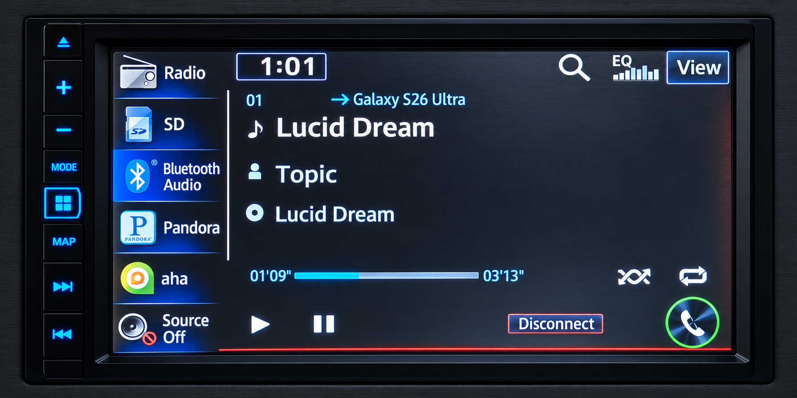

# Pioneer AVIC-X850BT - Bluetooth metadata fix · 1.07ES

Unofficial community firmware based on the original Pioneer EU130 1.06 update.
Restores Bluetooth song information on a tested AVIC-X850BT while the Android
phone remains set to AVRCP 1.6, with larger music text and a charcoal/red theme.



*Illustrative product photo based on the working Bluetooth Audio screen.*

## Features

- Bluetooth song title, artist and album information with Android AVRCP 1.6.
- Existing play/pause and next/previous controls retained.
- Larger, easier-to-read text on the Bluetooth Audio screen.
- Charcoal/red theme across audio sources, alongside existing Pioneer controls.
- Firmware update version **1.07**, with **Ver 1.07ES** in the English
  Information-page popup.

The fix uses the head unit's existing AVRCP 1.3 metadata method while the phone
stays set to 1.6. Bluetooth browsing is disabled on that path. Map data and
component version data are unchanged; this release adds no CarPlay or Android Auto.

## Compatibility

The following seven models belong to the matching Pioneer 1.06 update family.
**Tested** means the fix has been confirmed on a real unit. **Expected** means
the original firmware is shared or identical, but the modified firmware still
needs confirmation on that model.

| Model | Region covered by the original update | Status and evidence |
|---|---|---|
| **AVIC-X850BT** | United States / Canada | **Tested:** Bluetooth metadata, larger text and clean screen rendering confirmed. |
| **AVIC-X950BH** | United States / Canada | **Expected:** included with X850BT in Pioneer's shared 1.06 update notice. |
| **AVIC-Z150BH** | United States / Canada | **Expected:** included with X850BT in Pioneer's shared 1.06 update notice. |
| **AVIC-F50BT** | Europe / Russia | **Expected:** official 1.06 firmware matches our original package byte-for-byte. |
| **AVIC-F950BT** | Europe / Russia | **Expected:** official 1.06 firmware matches our original package byte-for-byte. |
| **AVIC-F950DAB** | Europe / Russia | **Expected:** official 1.06 firmware matches our original package byte-for-byte. |
| **AVIC-F850BT** | Europe / Russia | **Expected:** official 1.06 firmware matches our original package byte-for-byte. |

The confirmed setup is **AVIC-X850BT + Samsung Galaxy S26 Ultra + Spotify**,
with the phone's AVRCP setting at **1.6**. Other phones and apps have not been
validated. The six expected models are candidates for testing, not additional
hardware-confirmed results; DAB and other model-specific functions have not
been tested with this modification.

### Firmware evidence

- Pioneer's January 2014 [North American 1.06 notice](https://www.manualslib.com/manual/996725/Pioneer-Avic-Z150bh.html)
  lists X850BT, X950BH and Z150BH together. The link is an archived copy of
  Pioneer's original notice.
- Pioneer's [European/Russian 1.06 instructions](https://pioneer-car.eu/uk/asset/software_and_firmware/FIRMWARE_ID_19149/be20c8ecb38e49dbc188314ce5babca164c48c94/update_instructions)
  list F50BT, F950BT, F950DAB and F850BT together, using the `AVICX850` update
  folder. The folder name therefore does not limit the package to the X850BT.
- All **78 files** in the official European download variants linked from
  [F50BT](https://pioneer-car.eu/avic-f50bt/avic-f50bt),
  [F950BT](https://pioneer-car.eu/avic-f950bt/avic-f950bt),
  [F950DAB](https://pioneer-car.eu/avic-f950dab/avic-f950dab) and
  [F850BT](https://pioneer-car.eu/avic-f850bt/avic-f850bt) were compared with
  the untouched 1.06 package used to build this release: **zero differences**.

The matching original `PLATFORM/EU130PLT.PRG` SHA-256 is:

```text
49c559947b8a7384bea23223ef0a702b17b48c7b3faee34e1be8a48e5cec8571
```

Research checked **October 25, 2026**. Compatibility has not been established
for other AVIC, AVH or NEX models, or market variants outside the regions above.
A similar model name or a firmware version of 1.06 alone is not sufficient.
Package verification results are in [verification.json](docs/verification.json).

## Installation

1. Check the model and current **Application Version** in Service Information.
   The ordinary Information-page popup is not the updater's numeric version.
2. This package is for an installed update version **below 1.07**, such as the
   matching original 1.06. The updater requires a strictly higher number.
   It cannot install over version 1.07 or higher.
3. Copy this repository's **AVICX850** folder to the root of a blank FAT32
   SD or microSD card, as required by your model. The card must contain `AVICX850/APL` and
   `AVICX850/PLATFORM`. Avoid an extra nested repository folder on the card.
4. Follow the normal update procedure for this model with stable power, and
   allow the update and restart to finish. Do not interrupt power or remove
   the card during the update. Settings and Bluetooth pairings may reset.
5. Remove the update card when finished. Re-pair the phone if necessary.
   Leave Android's AVRCP setting at **1.6**.

After installation, check song changes, long titles, next/previous, play/pause,
volume overlays, source changes and disconnect/reconnect. Check the English
version popup for `Ver 1.07ES`. Report the exact model, region, phone, app,
installed version and steps to reproduce any problem; redact private data.

The numeric version 1.07 is a **custom release number**, not an official Pioneer
update. Stock 1.06 will not normally reinstall over it because it is lower.
This repository does not include a recovery image. Use an appropriate recovery
procedure if required; do not force a lower version through the updater.

## Repository contents

| Path | Purpose |
|---|---|
| `AVICX850/` | Ready-to-copy update-card folder |
| `tools/build.py` | Rebuild from an untouched matching original 1.06 package |
| `tools/pioneer_fw.py` | Manifest and firmware checksum verification |
| `assets/av-background.bmp` | Firmware background, 680×483, 24-bit BMP |
| `docs/verification.json` | Checks and hashes for this build |
| `docs/TECHNICAL.md` | Patch behavior and resource details |
| `SHA256SUMS.txt` | SHA-256 for every update payload file |

## Verify or rebuild

Verify the included update with Python 3.10 or later:

```powershell
python tools/pioneer_fw.py verify AVICX850
```

Rebuild on Windows using Python 3.10+ and the Windows `makecab.exe` utility.
No pip packages are required. Obtain an untouched matching original 1.06
package separately; the builder rejects an unexpected original PRG.

```powershell
python tools/build.py C:/firmware-original/AVICX850 C:/firmware-built/AVICX850 --work C:/firmware-work
```

Choose a new output directory. The script checks the original package, applies
the changes, verifies compressed-resource round trips and checksums, and writes
a verification report in the work directory.

See [NOTICE.md](NOTICE.md) for third-party ownership and attribution.
